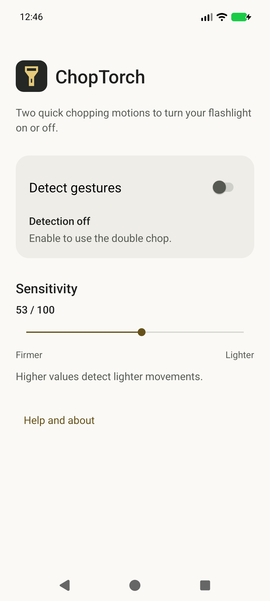

# ChopTorch

Toggle your flashlight with a double chop.

A native app for **Android 17 (API 37) only**, with adjustable sensitivity, a silent
notification to stop detection, English/French UI and system light/dark themes.

## Download

- [GitHub: 0.6-beta.1](https://github.com/Nauss/chop-torch/releases/tag/v0.6-beta.1) — signed beta APK and `SHA256SUMS`.
- [Personal F-Droid repository](https://nauss.github.io/chop-torch/) — add-repository link and verification fingerprint. **Not the official F-Droid catalogue.**

Verify the APK checksum or repository fingerprint before installing. Allow
installation from your chosen source only if Android requires it.

## Use

1. Open ChopTorch. Detection is **off** on first launch.
2. Enable **Detect gestures** and grant notification permission when prompted.
3. Hold the phone securely and make two quick chopping motions to turn the light on or off.
4. Adjust **Sensitivity** if needed; higher values detect lighter movements. Stop detection in the app or its notification.

Background gestures depend on your device's battery management and sensor behaviour
during deep sleep; continuous availability is not guaranteed.

## Privacy

Offline, with no ads, tracking or accounts. Motion data is processed in memory;
settings stay on your device. No Internet or camera permission is required.

## License

[GPL-3.0-or-later](LICENSE), without warranty.
