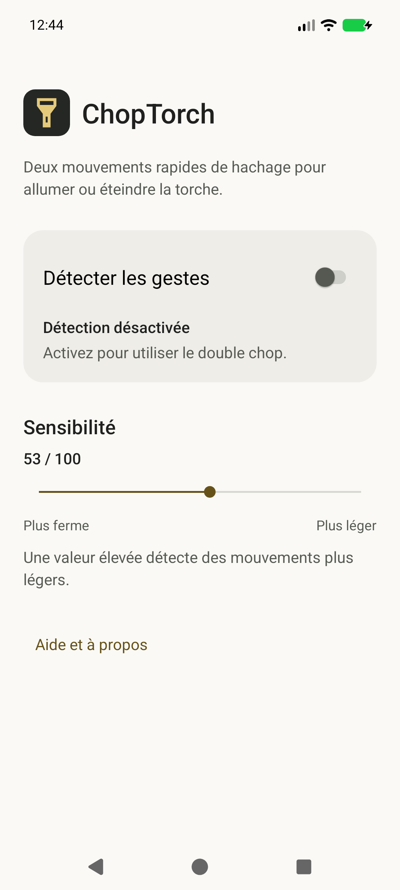
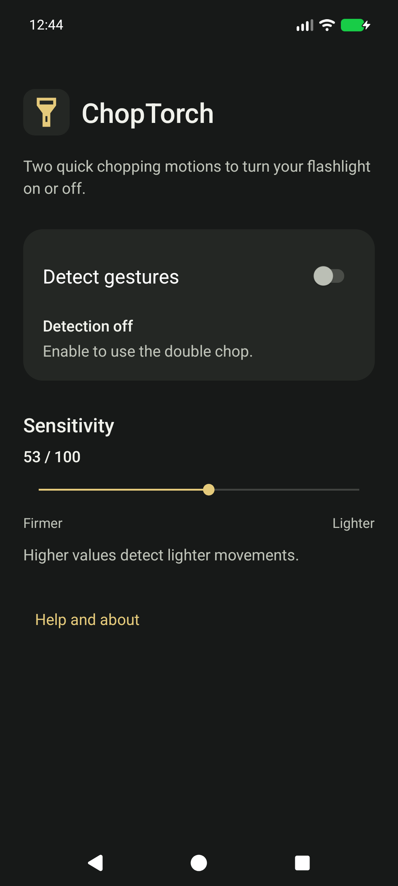

# ChopTorch


**FR** — Deux mouvements de hachage consécutifs allument ou éteignent la torche. Application native Kotlin / Android Views, **Android 17 / API 37 uniquement**, interface FR/EN, thèmes système clair/sombre. Aucun lien avec Motorola.

**EN** — Toggle the flashlight with two consecutive chopping gestures. Native Kotlin / Android Views, **Android 17 / API 37 only**, FR/EN UI and system light/dark themes. No Motorola affiliation.

## Installation / Install

- [GitHub prerelease 0.6-beta.1](https://github.com/Nauss/chop-torch/releases/tag/v0.6-beta.1) — APK signé / signed APK, code **6**, package `fr.nauss.choptorch`.
- [Dépôt personnel F-Droid / Personal F-Droid repository](https://nauss.github.io/chop-torch/) — **bêta, pas le catalogue officiel / beta, not the official catalogue**.
- URL : `https://nauss.github.io/chop-torch/fdroid/repo`
- Empreinte dépôt / repository SHA-256 fingerprint :
  `C1AC9D8BEAB479AE4D677D6CA131BFDCA6AC0D165350440AC0E046F401B1CC9F`

Comparer l’empreinte avant de confirmer l’ajout dans F-Droid. Vérifier l’APK contre `SHA256SUMS`. Autoriser l’installation depuis la source choisie uniquement si nécessaire. Ouvrir l’application, accepter les notifications puis activer volontairement la détection. L’installation démarre **désactivée**.

Compare the fingerprint before trusting the repository. Verify the APK against `SHA256SUMS`. Allow installation from the chosen source only if needed. Open the app, grant notifications and explicitly enable detection. Fresh installs start **off**.

L’ancien paquet `.diagnostic` reste indépendant : **arrêter son détecteur avant d’activer le nouveau**. Aucune désinstallation ni migration silencieuse des préférences. / The old `.diagnostic` package remains independent: **stop its detector before enabling the new one**. No silent preference migration.

## Bêta et limites / Beta limitations

Le moteur gestuel 0.4 accepté par le propriétaire reste inchangé. Tests JVM, lint et scénarios lifecycle sur émulateurs API37 ont été exercés ([P2](docs/FINISH_P2.md)). Cela ne prouve **ni premier geste après veille profonde, ni coût batterie24h, ni endurance72h**. Un service vivant ne garantit pas la réception pendant la suspension d’un capteur non-wake-up. Pas de wake lock permanent ni boucle de maintien.

The accepted 0.4 gesture engine is unchanged. JVM/lint and API37 emulator lifecycle tests do **not** establish deep-sleep first-gesture reliability, 24-hour energy cost or 72-hour endurance. A running service does not guarantee sensor delivery during suspend, especially with non-wake-up hardware. No permanent wake lock or keepalive loop.

Consentement sauvegardé : reprise système après mort de processus, boot après premier déverrouillage et mise à jour, dans les limites Android. Arrêt volontaire/système, force-stop, refus des notifications et restrictions respectés. / Saved consent permits system recovery after process death, boot after first unlock and package replacement within Android limits. Stops, force-stop, notification denial and restrictions are respected.

Première version publique : **mise à jour entre deux vraies versions publiques pas encore exercée**. Reproductibilité intermachines/F-Droid non démontrée. Aucune acceptation au catalogue officiel annoncée. / First public version: no two-release update test yet. Cross-machine/F-Droid reproducibility and official catalogue acceptance are not established.

## Confidentialité / Privacy

Hors ligne : permission `INTERNET` absente, aucun compte, publicité, analytics, Play Services, audio ou haptique. Mesures traitées en mémoire, sans capture, export, journal ni stockage partagé. Seules sensibilité, intention d’activation et date locale de modification sont conservées, sans sauvegarde Android. Historique de sortie du propre processus consulté localement pour respecter les arrêts, jamais exporté. API torche seulement, sans flux caméra ni permission `CAMERA`. Le lien source ouvre le navigateur externe sur action utilisateur.

Offline: no Internet permission, account, ads, analytics, Play Services, audio or haptics. Sensor data stays in memory; no capture/export/log/shared storage. Only sensitivity, activation consent and its local change time persist, without Android backup. Own process exit history is consulted locally to respect stops, never exported. Torch API only, no camera stream or camera permission. Source links open an external browser on user action.

## Sources et build / Source and build

Sources exactes de l’APK / exact APK source : [`75319a44ab4f268239ab7dd3c8170a49e1f70c37`](https://github.com/Nauss/chop-torch/tree/75319a44ab4f268239ab7dd3c8170a49e1f70c37), tag `v0.6-beta.1`. Les changements documentaires ultérieurs ne modifient pas cet APK. / Later documentation changes do not alter that APK.

JDK **21**, SDK Platform **37.0** (revision 2 used), Build Tools **37.0.0**, `ANDROID_HOME`. Pinned AGP **9.3.3**, Gradle **9.5.0**, built-in Kotlin **2.2.10**, JUnit **4.13.2**. Accepter soi-même les licences SDK / accept SDK licences yourself.

```sh
./gradlew --console=plain clean :app:testDebugUnitTest :app:lintDebug :app:lintRelease :app:assembleDebug :app:assembleRelease
python -m unittest discover -s tools -p 'test_*.py'
# Windows: gradlew.bat with the same arguments
```

Release unsigned : `app/build/outputs/apk/release/app-release-unsigned.apk`. Aucun coffre ni keystore requis au build / no credentials required to build. Debug : package `.diagnostic`, ne pas diffuser comme release / not a public release. [Signature et sauvegarde / signing and backup](docs/SIGNING.md), [décisions techniques / technical decisions](docs/DECISIONS.md), [changelog](CHANGELOG.md). Rapports antérieurs : [P1](docs/FINISH_P1.md), [P2](docs/FINISH_P2.md) ; ils décrivent leur état historique, pas une publication.

Certificat APK / APK certificate SHA-256 :
`6E1EDEEB4E4A610A0430C9287CC274AF9DD7388F9D6AB7B891B5C61568FE2D3F`

## Captures natives / Native screenshots

 

## Licence / License

Copyright (C) 2026 Nauss et contributeurs. **GPL-3.0-or-later**, sans garantie / without warranty. [LICENSE](LICENSE). Wrapper Gradle : Apache-2.0 ; les dépendances conservent leurs licences / dependencies retain their own licences. Aucun code ou logo propriétaire Motorola / no proprietary Motorola code or logo.
